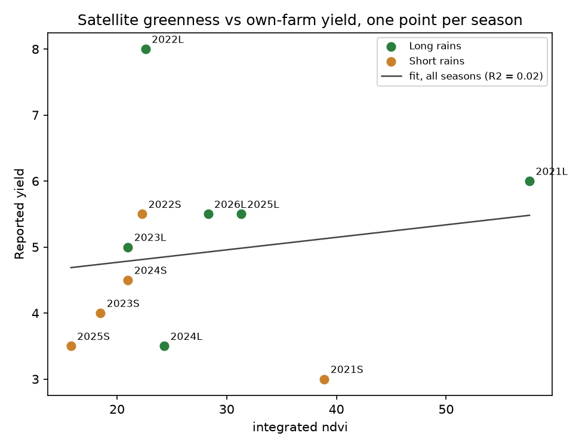

# Maize NDVI and rainfall vs own-farm yield (Kenya)

A small remote-sensing validation study. Can satellite greenness (Sentinel-2 NDVI) or regional rainfall
(NASA POWER) explain the yield of my own smallholder maize plots, season by season?

**Short answer: no, not at this plot size.** Over 11 seasons (long and short rains, 2021 to 2026), neither
NDVI nor any of five rainfall measures explained yield better than guessing the average. The value of the project is the
pipeline, the data-quality steps and an honest account of why the signal is missing.

## Results

Yield is in 90 kg sacks per acre, from my own farm records (sacks divided by 2 acres). Practices were the same
every season (fertiliser at planting, DAP top-dressing at about 5 weeks, pest spraying, harrowing at about one month).

| Season | Peak NDVI | Integrated NDVI | Clean observations | Yield (sacks/acre) |
|---|---|---|---|---|
| 2021L | 0.640 | 57.6 | 18 | 6.0 |
| 2021S | 0.687 | 38.9 | 8 | 3.0 |
| 2022L | 0.480 | 22.6 | 15 | 8.0 |
| 2022S | 0.543 | 22.3 | 15 | 5.5 |
| 2023L | 0.515 | 21.0 | 9 | 5.0 |
| 2023S | 0.467 | 18.5 | 9 | 4.0 |
| 2024L | 0.491 | 24.3 | 16 | 3.5 |
| 2024S | 0.496 | 21.0 | 20 | 4.5 |
| 2025L | 0.557 | 31.3 | 21 | 5.5 |
| 2025S | 0.426 | 15.8 | 15 | 3.5 |
| 2026L | 0.528 | 28.3 | 29 | 5.5 |

L = long rains (plant March, harvest August). S = short rains (plant October, harvest February).

**Satellite greenness vs yield** (11 seasons):

| Measure | Pearson r | R² | Leave-one-out RMSE (sacks/acre) |
|---|---|---|---|
| Peak NDVI | -0.04 | 0.00 | 1.88 |
| Integrated NDVI | +0.16 | 0.02 | 1.65 |

The normal spread of yield (standard deviation) is 1.36 sacks per acre, so an error of 1.65 to 1.88 is no better than
predicting the average.

**Rainfall vs yield** (NASA POWER daily rainfall; planting assumed on 1 March or 1 October):

| Rainfall measure | r | R² |
|---|---|---|
| Total season rain | +0.18 | 0.03 |
| Rain in first 60 days | +0.37 | 0.14 |
| Rain in days 30 to 100 | -0.03 | 0.00 |
| Longest dry spell, days 30 to 100 | +0.07 | 0.00 |
| Wet days (at least 1 mm) | +0.19 | 0.04 |

Five measures were tested on 11 seasons, so one can look good by chance. The corrected p-value for the best one
(permutation test on the strongest correlation) is **0.64**, so there is no evidence of a real relationship.



## Why the signal may be missing

- **Small plots.** The mapped sections cover about 46 satellite pixels (10 m), and two of the three sections are only
  8 to 12 m wide, so many pixels mix maize with neighbouring land.
- **Partial coverage.** The mapped outlines cover about 1.2 of the 2 acres that the yields come from.
- **Few seasons.** 11 points cannot detect a weak relationship.
- **Rainfall is regional.** NASA POWER cells are about 50 km wide, so they miss local rain patterns.
- **Planting date is assumed.** Rainfall windows start on 1 March or 1 October. Actual planting dates can be added in
  `data/planting_dates.csv`.
- **Other yield drivers** that no satellite sees: seed, pests, harvest and drying losses, how sacks were counted.

## How it works

1. `02_ndvi.py` searches Sentinel-2 L2A scenes (Microsoft Planetary Computer), reads only the small window over the
   plots, removes cloud and shadow using the scene classification layer, keeps only pixels whose centre is inside the
   plot outlines, and calculates the mean NDVI per date.
2. `04_multi_year.py` repeats this for every long- and short-rain season and retries failed downloads.
   `metrics.py` averages same-day scenes, removes spikes (missed cloud), flags thin seasons and long gaps, and
   calculates peak NDVI, integrated NDVI and green-up day.
3. `05_validate.py` compares the NDVI measures with yield (correlation, R², leave-one-out error).
4. `06_rain_vs_yield.py` does the same for five rainfall measures and adds a corrected p-value for testing several
   measures at once.
5. `01_weather.py` and `03_combine_plot.py` make a one-year NDVI and rainfall chart.

## Run it

```
pip install -r requirements.txt
python 04_multi_year.py      # downloads NDVI, 3 to 10 min per season
python 05_validate.py        # NDVI vs yield
python 06_rain_vs_yield.py   # rainfall vs yield
```

The plot outlines of my farm are private and not in this repository. Without them the code uses a made-up example
rectangle (see `config.py`). To use your own plot, create `config_private.py` with your own `POLYGONS` list drawn on
geojson.io, and put your own yields in `data/yields.csv`.

## Data sources

- Sentinel-2 L2A imagery: Microsoft Planetary Computer (open)
- Rainfall: NASA POWER (open)
- Yield: own farm records

## Next steps

- Use the real planting date of each season.
- Mask to cropland (ESA WorldCover) and use larger plots or several farms to reduce mixed pixels.
- Collect field-level ground truth (crop cutting or KoboToolbox surveys) for more than one farm.

*Author: Antony Mutwiri Kabicii. MIT licence.*
